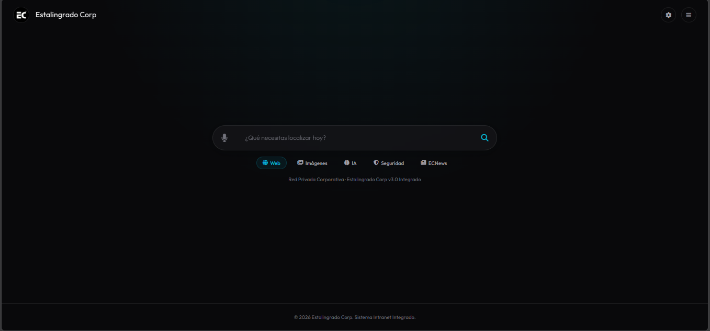
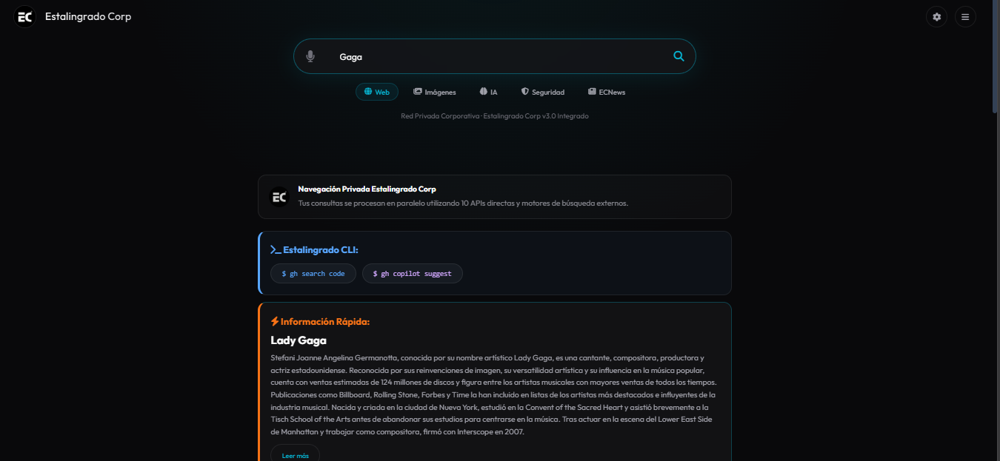
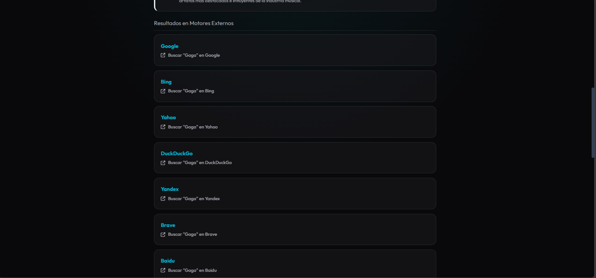
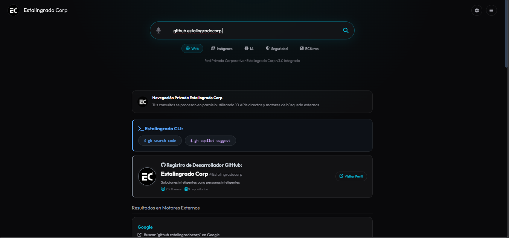

# Estalingrado Corp | Intranet PRO


> Sistema de búsqueda y dashboard corporativo integrado con estética Aurora Cyber. Opera 100% en el navegador sin backend.

---

## Descripción

Estalingrado Corp Intranet PRO es una interfaz de búsqueda y dashboard profesional que combina múltiples motores de búsqueda, herramientas de privacidad y widgets informativos en una experiencia visual cyber/aurora con glassmorphism.

---

## Capturas

**1.** 

**2.** 

**3.** 

**4.** 

---

## Características Principales

### Búsqueda Multimotor
Consulta simultánea a 18 motores de búsqueda:
- Google, Bing, Yahoo, DuckDuckGo, Yandex, Brave
- Baidu, Startpage, Ecosia, SearXNG, Mojeek
- Gibiru, Swisscows, Ask.com, AOL, Naver, Sogou
- Wikipedia, Internet Archive

### Tarjetas Inteligentes (APIs Integradas)
| API | Uso |
|-----|-----|
| DuckDuckGo | Información rápida |
| Wikipedia REST | Resúmenes de artículos |
| Open-Meteo | Clima actual |
| Nominatim | Geocodificación + Mapas Leaflet |
| CoinGecko | Precios de criptomonedas |
| Open Library | Información de libros |
| iTunes Search | Música y podcasts |
| TVMaze | Información de series |
| GitHub API | Perfiles de usuario |
| PokeAPI | Datos de Pokémon |
| Dog CEO | Imágenes de perros |
| Internet Archive | Búsqueda histórica |
| Free Dictionary | Definiciones |
| REST Countries | Información de países |
| TheMealDB | Recetas de cocina |
| SpaceX API | Lanzamientos espaciales |
| Hacker News | Noticias tecnológicas |

### Modos de Búsqueda
- **Web** - Búsqueda estándar multimotor
- **Imágenes** - Búsqueda visual multisource
- **IA** - Acceso directo a ChatGPT, Gemini, Perplexity, DeepSeek, Claude, Copilot
- **Seguridad** - Auditoría de exposición con Shodan (ver abajo)
- **OSINT** - Inteligencia de fuentes abiertas sin API keys (ver abajo)

### Modo OSINT (Inteligencia de Fuentes Abiertas)
Detecta automáticamente el tipo de dato y consulta fuentes públicas en paralelo, sin backend ni API keys.

| Tipo detectado | Consultas automáticas |
|----------------|----------------------|
| IP | Geolocalización/ASN (ipwho.is), puertos, hostnames y CVEs (Shodan InternetDB) |
| Dominio | DNS A/AAAA/MX/NS/TXT/DMARC (Google DNS), registro RDAP, subdominios por Certificate Transparency (Cert Spotter con respaldo crt.sh), histórico (Wayback Machine) |
| Email | Avatar Gravatar (solo se envía el hash MD5), MX y SPF/DMARC del dominio |
| Usuario | Cuenta pública de GitHub + enlaces a 12 plataformas |
| Hash | Identificación MD5/SHA-1/SHA-256 + enlaces a VirusTotal, MalwareBazaar, Hybrid Analysis y Triage |
| URL | Componentes de la URL, análisis del dominio subyacente e histórico Wayback |
| Teléfono | Normalización local + enlaces de búsqueda inversa |

Además genera **Google Dorks** según el tipo y un **directorio de herramientas OSINT** filtrado (Shodan, VirusTotal, AbuseIPDB, SecurityTrails, urlscan.io, HIBP, Intelligence X, OSINT Framework, Bellingcat, CyberChef, etc.).

> **Ética y límites:** solo se consultan fuentes públicas y datos pasivos. No se realizan escaneos activos, fuerza bruta ni intentos de acceso. Respeta los términos de cada servicio y la privacidad de terceros. Las fuentes gratuitas tienen límites de uso.

### Modo Seguridad (Shodan)
Herramienta de auditoría de exposición: descubre qué servicios tiene públicos una IP o busca dispositivos conectados a Internet (cámaras IP, RTSP, VNC, Telnet, FTP, etc.).

- El usuario pega su API key de Shodan (gratuita en https://account.shodan.io/)
- La key se guarda solo en `localStorage` del navegador y se envía únicamente a `api.shodan.io`
- Si la query es una IP → `/shodan/host/{ip}` (gratis, sin créditos)
- Si es texto → `/shodan/host/count` gratis para totales + botón explícito para `/shodan/host/search` (1 crédito)
- Plan gratuito: 100 consultas/mes
- Solo muestra metadatos públicos: IP, puertos, banners, org, ubicación, CVEs. Sin screenshots ni streams

Queries rápidas incluidas: `webcam`, `product:"webcamxp"`, `title:"IP Camera"`, `port:554` (RTSP), `netcam`, `port:5800` (VNC), `port:23` (Telnet), `port:21` (FTP).

### Herramientas de Privacidad
| Herramienta | Descripción |
|-------------|-------------|
| Generador de Claves | Contraseñas robustas (8-32 caracteres) |
| Auditoría de Email | Verificación de filtraciones |
| Scanner de URL | Análisis de enlaces sospechosos |
| Generador QR | Crea códigos QR al instante |
| Limpieza Digital | Borra datos locales |

### Intranet Corporativa (Menú Desplegable)

El menú desplegable del header organiza los accesos en tres secciones:

| Sección | Enlace | Comportamiento |
|---------|--------|----------------|
| **Intra-net** | Intra-net Web | Misma pestaña |
| | EC Market | Misma pestaña |
| | EC Download | Misma pestaña |
| | ECSend (Transferencia de archivos) | Misma pestaña |
| | EC Channel | Misma pestaña |
| | ECnews | Misma pestaña |
| **Administrativo** | Big-Data | Misma pestaña |
| | Página de la Empresa | Misma pestaña |
| **Soporte** | Soporte | Misma pestaña (`https://estalingradocorp.qzz.io/`) |
| | Guía de Uso | Modal interno |
| | Privacidad | Modal interno |

#### Enlaces actuales
- Intra-net Web: `https://estalingradocorp.github.io/Intra-net/`
- EC Market: `https://estalingradocorp.com.ar/market.html`
- EC Download: `https://nicotips27.github.io/ec-download/`
- ECSend: `https://nicotips27.github.io/ECwebSend/`
- EC Channel: `https://nicotips27.github.io/EC-chanel/`
- ECnews: `https://nicotips27.github.io/ECnews/`
- Big-Data: `https://nicotips27.github.io/ec-Intra-net/`
- Página de la Empresa: `https://estalingradocorp.com.ar/`

> **Nota:** Todos los accesos web abren en la misma pestaña (sin `target="_blank"`). "EC OS" fue eliminado del menú.

---

## Instalación

### Requisitos
- Navegador moderno (Chrome, Edge, Firefox, Safari)
- Soporte ES6+, localStorage
- Web Speech API (opcional, para voz)

### Paso 1: Clonar
```bash
git clone https://github.com/nicotips27/Estalingrado-corp-Buscador-.git
cd Estalingrado-corp-Buscador-
```

### Paso 2: Abrir
Abre `index.html` en tu navegador o usa un servidor local:
```bash
# Con Python
python -m http.server 8000

# Con Node.js
npx serve .
```

---

## Atajos de Teclado

| Atajo | Acción |
|-------|--------|
| `Ctrl + K` | Enfocar barra de búsqueda |
| `Ctrl + D` | Abrir/Cerrar Dashboard |
| `Enter` | Ejecutar la búsqueda |
| `Esc` | Cerrar menús/modales o detener voz |

---

## Guía de Uso Rápida

### 1. Elegí el modo correcto

| Pestaña | Para qué sirve | Ejemplo |
|---------|----------------|---------|
| **Web** | Busca en los motores activos y muestra tarjetas inteligentes | `inteligencia artificial` |
| **Imágenes** | Abre la consulta en Google, Bing, Yandex, DuckDuckGo y Pinterest | `paisajes de montaña` |
| **IA** | Lleva la pregunta a ChatGPT, Gemini, Perplexity, Claude o DeepSeek | `explicá blockchain` |
| **Seguridad** | Shodan: puertos y servicios expuestos de una IP o dispositivo (requiere API key) | `8.8.8.8` |
| **OSINT** | Analiza IP, dominio, email, usuario, hash, URL o teléfono sin API keys | `example.com` |
| **ECNews** | Dashboard de noticias, clima y prensa LATAM | Botón ECNews |

### 2. Comandos con barra

| Comando | Qué hace |
|---------|----------|
| `/ai [pregunta]` | Respuesta simulada local. Para IA real usá la pestaña **IA** |
| `/clima [ciudad]` | Clima real con Open-Meteo. También funciona `clima en [ciudad]` |
| `/traducir [texto]` | Traducción simulada local (no envía el texto a ningún servicio) |

> Escribí el comando con un espacio antes del dato: `/clima Madrid`, no `/climaMadrid`.

### 3. Palabras que activan tarjetas en modo Web

| Escribí | Tarjeta |
|---------|---------|
| `clima en Madrid` · `/clima Madrid` | Clima actual |
| `precio bitcoin` · `acciones apple` | Mercados y cripto |
| `github torvalds` | Perfil de GitHub |
| `pokemon pikachu` | Pokédex |
| `definir entropía` · `significado de sesgo` | Diccionario |
| `pais Japón` | Ficha del país |
| `receta paella` | Receta |
| `noticias inteligencia artificial` | Noticias tech |
| `libro Cien años de soledad` | Libros |
| `serie Dark` · `canción Bohemian Rhapsody` | TV / música |
| `spacex` | Último lanzamiento |
| `perro` | Foto aleatoria |
| `archivo historia de internet` | Internet Archive |
| `imagen de gatos` | Búsqueda de imágenes |
| Una ciudad o país solo | Mapa + clima (OpenStreetMap) |
| Cualquier entidad corta | Wikipedia + DuckDuckGo |

### 4. OSINT en 10 segundos

1. Abrí la pestaña **OSINT**.
2. Pegá un dato (`8.8.8.8`, `example.com`, `ana@example.com`, `torvalds`, un hash, una URL o un teléfono).
3. Mirá las tarjetas: DNS, RDAP, subdominios, puertos, reputación y presencia pública.
4. Usá los **Google Dorks** y el **directorio de herramientas** para profundizar.

> La guía dentro de la app (menú ☰ → **Guía de Uso**) incluye ejemplos clicables que ejecutan la búsqueda directamente.

---

## Estructura del Proyecto

```
Estalingrado-corp-Buscador-/
├── index.html          # Marcado HTML (head, layout, modales)
├── style.css           # Todos los estilos (estética Aurora Cyber)
├── app.js              # Toda la lógica (búsqueda, APIs, widgets)
├── osint.js            # Modo OSINT (detección de tipo, fuentes públicas, dorks)
├── assets/
│   ├── logo.jpg        # Logo local (sin dependencia de CDN externo)
│   └── screenshots/    # Capturas numeradas (01.png - 04.png)
└── README.md           # Documentación
```

---

## Personalización

### Cambiar Colores
Modifica las variables CSS en `:root`:
```css
--primary: #06b6d4;    /* Cyan */
--secondary: #8b5cf6;  /* Violet */
--dark-bg: #09090b;    /* Fondo oscuro */
```

### Agregar Motores de Búsqueda
Edita `CONFIG.searchEngines`:
```javascript
searchEngines: {
    MiMotor: query => `https://mi-motor.com/search?q=${encodeURIComponent(query)}`,
}
```

### Agregar Sitios de Acceso Rápido
Añade entradas a `CONFIG.knownSites`:
```javascript
{ 
    url: "https://ejemplo.com", 
    title: "Mi Sitio", 
    icon: "fas fa-star", 
    keywords: ["ejemplo", "mi sitio"] 
}
```

Los accesos del menú desplegable se editan directamente en `index.html`, dentro de `#menuPanel`. Cada sección usa `<strong>` como encabezado y los enlaces son `<a href="..."><i class="..."></i> Texto</a>`. Para que un enlace abra en la misma pestaña, no incluyas `target="_blank"`.

---

## Compatibilidad

| Dispositivo | Soporte |
|-------------|---------|
| Desktop (Chrome/Edge/Firefox/Safari) | ✅ Completo |
| Tablet | ✅ Responsive |
| Móvil | ✅ Adaptado |

---

## Privacidad

- ✅ 100% local (localStorage)
- ✅ Sin servidores propios
- ✅ APIs públicas directas desde el navegador
- ✅ Modo OSINT sin API keys: solo hashes y consultas públicas, nunca credenciales

---

## Enlaces Relacionados

- [EC Escritorio](https://nicotips27.github.io/EC-Escritorio/)
- [Intra-net Web](https://estalingradocorp.github.io/Intra-net/)
- [EC Market](https://estalingradocorp.com.ar/market.html)
- [EC Download](https://nicotips27.github.io/ec-download/)
- [ECwebSend](https://nicotips27.github.io/ECwebSend/)
- [EC Channel](https://nicotips27.github.io/EC-chanel/)
- [ECnews](https://nicotips27.github.io/ECnews/)
- [EC OS](https://nicotips27.github.io/EC-OS/)
- [Página de la Empresa](https://estalingradocorp.com.ar/)

---

**Desarrollado por Estalingrado Corp** — Sistema Intranet Integrado v3.0
